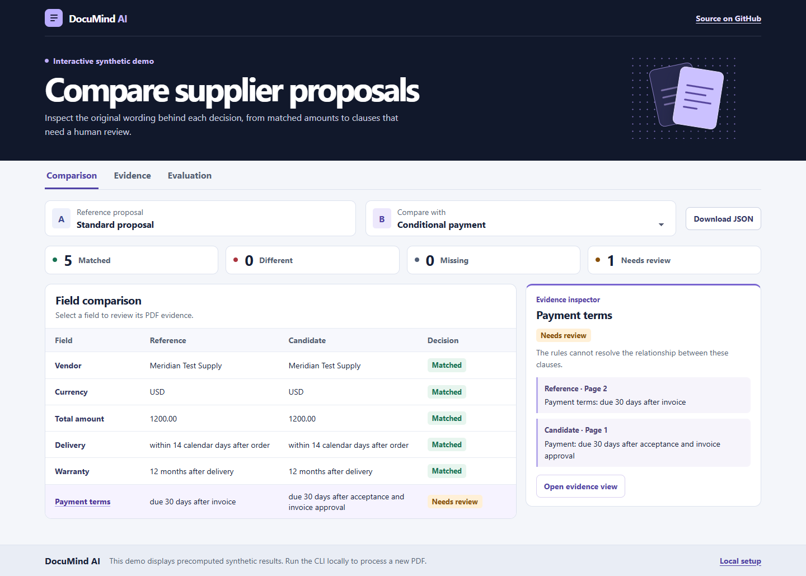

# DocuMind AI

DocuMind extracts commercial fields from locally stored, text-based PDFs, cites the original text and physical page, and compares two proposals. It routes ambiguous values and unsupported clause comparisons to review. The local CLI is the reproducible foundation demo.

[](https://stephanyalves-eng.github.io/documind-ai/)

**[Open the interactive recruiter demo](https://stephanyalves-eng.github.io/documind-ai/)** · [Desktop and mobile screens](docs/portfolio/README.md) · [Hosted quality checks](https://github.com/stephanyalves-eng/documind-ai/actions/workflows/ci.yml)

The browser demo uses 12 generated PDFs and 11 precomputed comparison scenarios. Inspect exact quotes, switch cases and download the matching synthetic PDFs and reports. Processing a new document uses the local CLI.

## Install

From the repository root with CPython 3.11–3.14 and compatible PyMuPDF wheels. Use a fresh virtual environment if migrating from the Python 3.15 foundation build. PyMuPDF 2.1 depends on ONNX Runtime, whose wheels currently determine the supported Python versions. The example uses PowerShell 7.4+ for UTF-8 command output redirection.

```powershell
python -m venv .venv
.\.venv\Scripts\Activate.ps1
python -m pip install -r requirements.lock
python -m pip install --no-deps --no-build-isolation -e .
```

On macOS and Linux, activate with `source .venv/bin/activate`. Dependency installation uses PyPI or a local wheelhouse. After setup, extraction, review and evaluation run offline.

## Reproduce the demo

```powershell
python -m scripts.generate_test_docs
New-Item -ItemType Directory -Force outputs
documind extract data/generated/standard.pdf > outputs/standard.json
documind compare data/generated/standard.pdf data/generated/equivalent.pdf --format csv
documind extract data/generated/conflict.pdf > outputs/conflict.json
documind correct outputs/conflict.json amount 1200 --reason "Confirmed total on page 1" > outputs/reviewed.json
documind verify outputs/reviewed.json data/generated/conflict.pdf
documind compare outputs/standard.json outputs/reviewed.json --reports --source-pdfs data/generated/standard.pdf data/generated/conflict.pdf
documind export outputs/reviewed.json > outputs/reviewed.csv
```

Review each field's observations, evidence and issues in the JSON. Corrections append a reason and validated value while retaining the original machine observations. Choose a new output filename when redirecting a correction. The verify command rechecks the PDF fingerprint and machine observations. Comparison JSON contains both reports and all six comparison decisions. CSV includes a row per machine evidence candidate and prefixes formula-like cells with an apostrophe.

Comparison output indicates whether machine evidence was checked against the PDFs. Comparisons based solely on saved reports carry `machine_evidence=unverified`. Add `--source-pdfs` to check both reports before comparing. Manual corrections remain separately attributed. For private values, pipe a local JSON object with `value` and `reason` into `documind correct REPORT FIELD --stdin`.

## Supported input

- Label-and-value lines for vendor, currency, total amount, delivery, warranty and payment. Optional labels cover subtotal, tax, issue date and validity date. The active label aliases are defined in [fields.toml](src/documind/fields.toml).
- Amounts accept unsigned decimal-point values with up to two fractional digits and optional thousands commas. Currencies require explicit USD, BRL, EUR, GBP or CAD codes. Dates use `YYYY-MM-DD`.
- Extraction returns `extracted`, `missing` or `needs_review`. An audited correction has effective status `manual`. Document validation flags inconsistent totals and inverted validity dates.
- Comparison returns `matched`, `different`, `missing` or `needs_review`. Clauses outside the supported patterns need review when their normalized text differs. Cross-currency totals go to review.
- PDFs are limited to 10 MiB, 50 pages and 500,000 extracted characters. Parsing runs in a worker with a 15-second timeout and additional Linux resource ceilings. Unreadable pages, including pages with detectable invisible text, block automatic comparisons. All-image, damaged and password-protected inputs are rejected with a CLI diagnostic and exit code 2.

## Reproduce evaluation and checks

```powershell
python -m scripts.evaluate --output outputs/benchmark.json
python -m pytest -q
python -m ruff check .
python -m ruff format --check .
python -m mypy
python -m pip check
```

To build and preview the static demo from the same synthetic fixtures:

```powershell
python -m scripts.build_showcase
python -m http.server 8765 --bind 127.0.0.1 --directory outputs/showcase
```

Open `http://127.0.0.1:8765/`. GitHub Pages packages the same static directory after the Linux quality jobs pass.

See the [security and quality audit](docs/audit.md), [evaluation protocol](docs/evaluation.md), [machine-readable run](docs/benchmark.json), [architecture](docs/architecture.md), [limitations](docs/limitations.md), [data policy](docs/data_policy.md) and [model card](model_card.md).

DocuMind AI uses [AGPL-3.0-only](LICENSE). Artifex offers PyMuPDF under AGPL and commercial terms. See [PyMuPDF licensing](https://pymupdf.readthedocs.io/en/latest/about.html#license-and-copyright).
