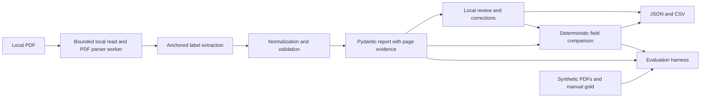

# Architecture

A CLI reads a bounded snapshot of a regular local file, computes a SHA-256 fingerprint and passes PDF bytes to a dedicated PyMuPDF subprocess through stdin. The worker has a wall-clock deadline and, on Linux, address space and CPU ceilings. The reader applies byte, page and extracted-character budgets and suppresses native parser diagnostics. It treats PDF text as untrusted data. OCR, network services and model downloads are outside the runtime path.

Explicit one-line labels map to canonical fields. Original extracted lines and physical one-based page indices travel with candidates. Decimal amounts, an explicit currency allowlist and ISO dates constrain automatic acceptance. Conflicts and invalid values abstain. Arithmetic checks compare subtotal plus tax with total when all three are present. An unreadable page or unresolved financial validation can block automatic field comparison.

Reports preserve machine observations when a reviewer supplies a corrected value and reason. The reviewer value has its own method and carries no machine citation. Saved reports can be checked against source bytes and observed fields before comparison. Comparison uses normalized equality for identifiers and exact Decimal amounts with resolved currency. Controlled payment, warranty and delivery patterns allow conservative equivalence. Unsupported clause relationships go to review. The harness also measures strict text equality on the same pairs.

## Implementation checklist

- PDF ingestion with local input limits and explicit rejection reasons.
- Typed extraction, immutable machine evidence, deterministic validation and review overrides.
- Comparison, JSON/CSV export and reproducible CLI demo.
- Versioned synthetic corpus, independent gold labels, per-case results and metric definitions.
- Regression tests, locked dependencies, CI and release limitations.
